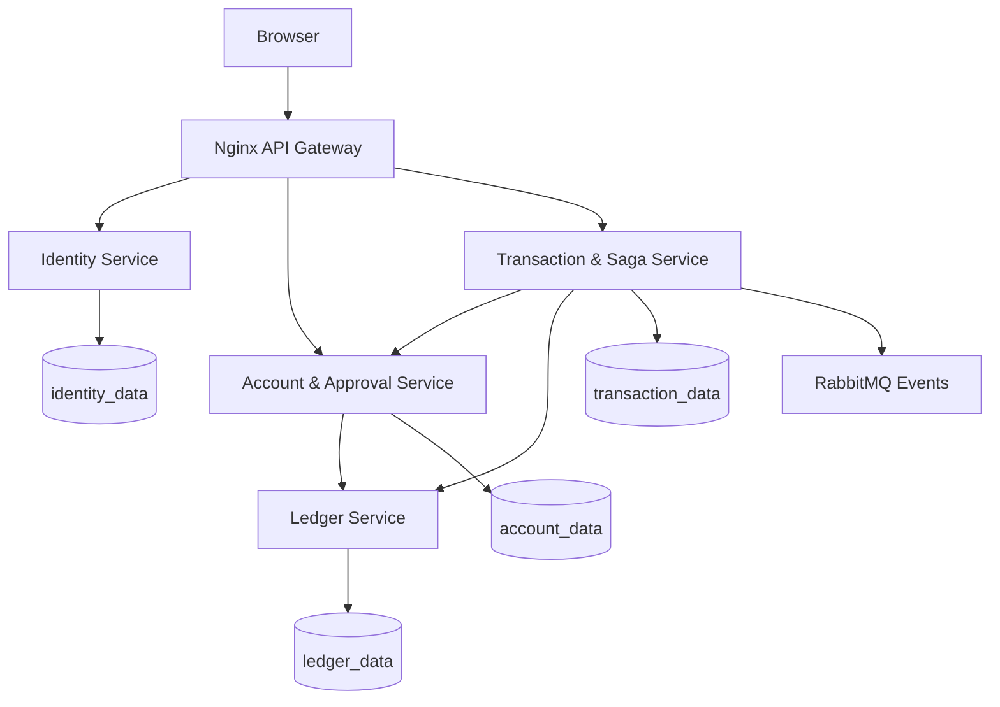
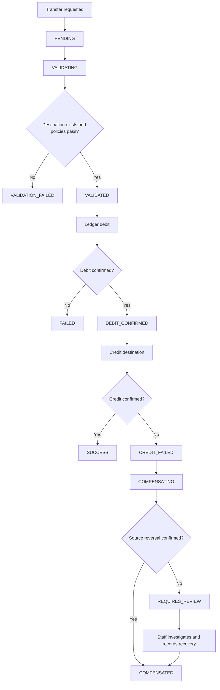

# Architecture and Activity Flows

## Transfer activity

A timeline contains only persisted stages reached by the transaction. Validation failures do not fabricate debit/credit or compensation events.

## Added modules
- Notification Service: independent SQLite store for short-lived OTP challenges; SMTP sends customer email-verification codes and transfer authorization codes. The transfer service verifies and consumes OTP internally before starting a customer transfer. SMTP secrets are supplied through `.env`.
- Branch ownership: staff identity tokens carry a branch claim; account-service filters staff queues and enforces branch matching for employee/manager operations. Admin is the cross-branch role.
- Fixed deposits: principal is debited from an existing account, the fixed-deposit record tracks a chosen term and maturity date, and a manual maturity action credits principal plus a demo simple-interest estimate.
- Loans: customer loan applications are scoped to a branch and require manager/admin approval before a demo ledger credit. Repayment/EMI functionality is intentionally outside this MVP.
- Optional Google Identity Services login: configured with `GOOGLE_CLIENT_ID`; the identity service validates the returned credential against Google's tokeninfo endpoint and requires a verified email.
